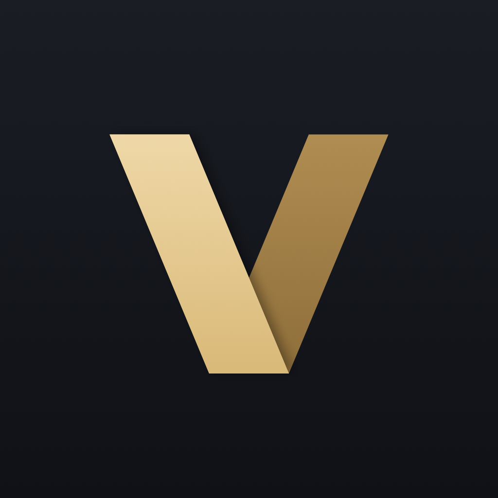
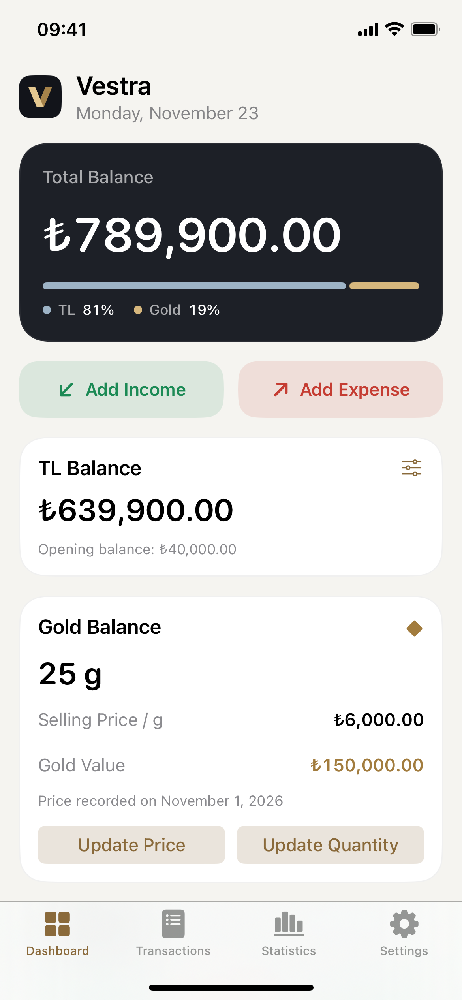
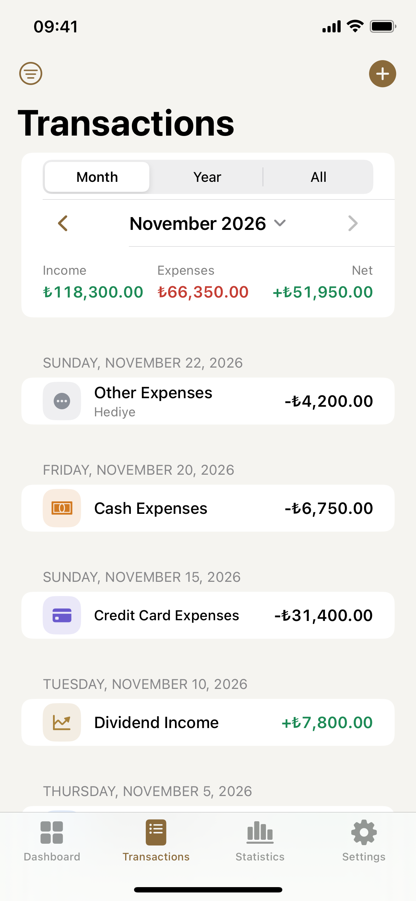
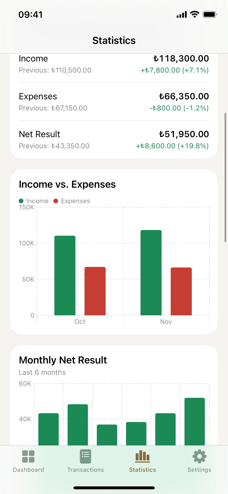
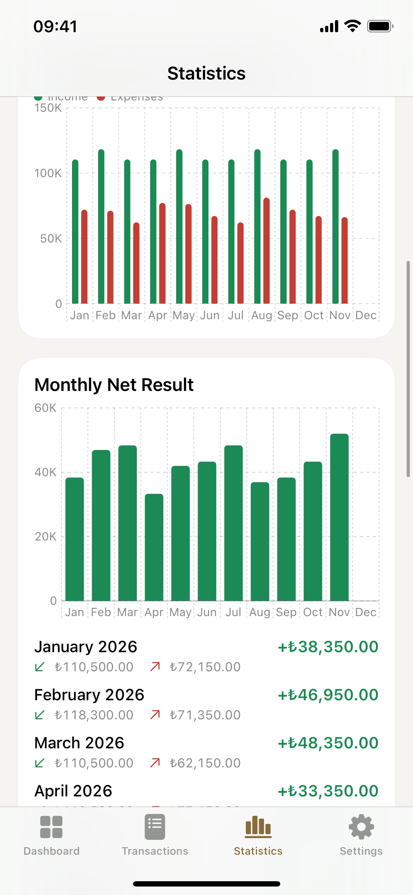
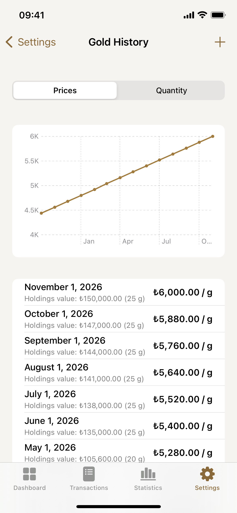
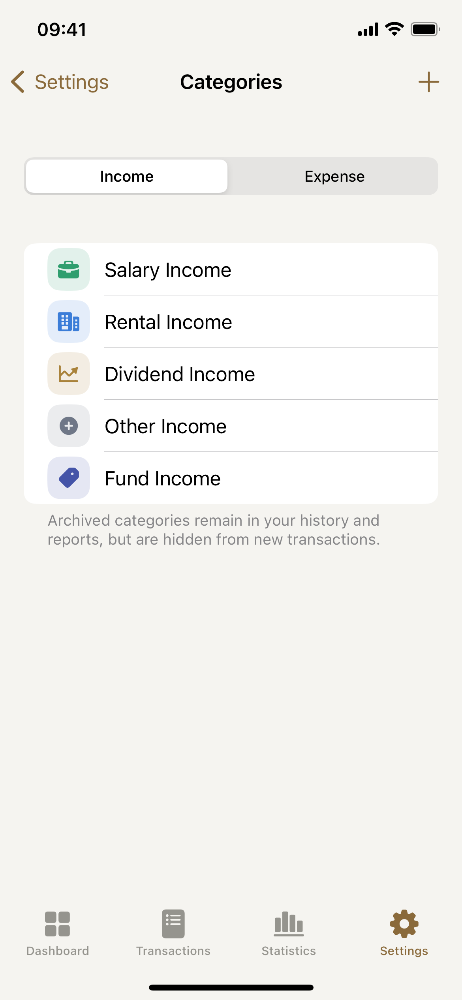
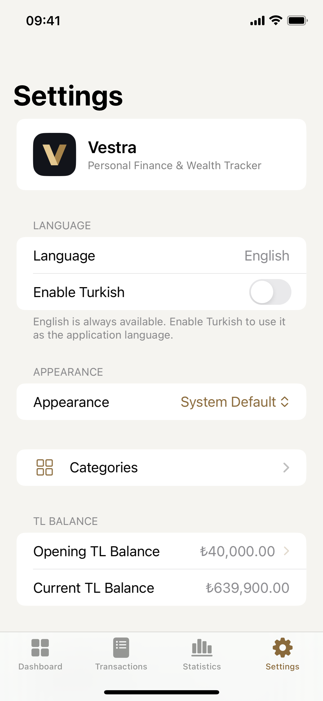

  

<h1 align="center">Vestra</h1>

  <strong>Your lira, your gold, your net worth.</strong>

  Vestra is a personal finance app for iPhone. It keeps your Turkish lira and your physical gold in one calm overview, then shows what the month and the year actually did.

## The app

Every screen below was captured from Vestra running on the iPhone 13 simulator.

<table>
  <tr>
    <td align="center" width="33%">
      
        
      <strong>Dashboard</strong>
       
      Total wealth at a glance: cash, gold, and the sum of the two.
    </td>
    <td align="center" width="33%">
      
        
      <strong>Transactions</strong>
       
      Income and expenses for the month, with a running net result.
    </td>
    <td align="center" width="33%">
      
        
      <strong>Monthly statistics</strong>
       
      How this month compares with the last, in numbers and in charts.
    </td>
  </tr>
  <tr>
    <td align="center" width="33%">
      
        
      <strong>Yearly statistics</strong>
       
      The shape of the year: every month of income, spending, and net result.
    </td>
    <td align="center" width="33%">
      
        
      <strong>Gold history</strong>
       
      Each selling price you record, and what your grams were worth that day.
    </td>
    <td align="center" width="33%">
      
        
      <strong>Categories</strong>
       
      A short list of income and expense categories, including ones you add yourself.
    </td>
  </tr>
  <tr>
    <td align="center" colspan="3">
      
        
      <strong>Settings</strong>
       
      English by default, Turkish when you want it, and light, dark, or system appearance.
    </td>
  </tr>
</table>

## What you can do

**See your wealth in one number.** Total balance is your Turkish lira plus the value of your gold. The dashboard shows both parts, and how they share the total.

**Track cash on its own.** Your TL balance is an opening amount, plus income, minus expenses. Gold never gets mixed into that figure.

**Value gold in grams.** Enter how many grams you hold and the selling price per gram. Vestra shows the value in lira. Updating the price does not create an income or an expense.

**Keep a price history.** Every gold price is saved with a date. When you look back at a month or a year, Vestra uses the price from that time, not the price today.

**Record income and expenses.** Salary, rent, dividends, card spending, cash, home costs, or categories you create. Each entry has an amount, a date, and an optional note. You can add, edit, or remove them, including dates from earlier months.

**Read the month and the year.** Statistics shows income, expenses, and the net result, then compares them with the previous period. Charts sit next to the exact amounts. A category breakdown shows where the money went, and where it came from.

**Name things your way.** Start from the built-in categories, or add your own with an icon and a color. Archive a category when you no longer use it. Past transactions keep the name they had.

**Switch language and appearance.** The app opens in English. Turn on Turkish in Settings when you want it, and switch between the two immediately. Choose Light, Dark, or follow the system.

**Keep the data with you.** Everything stays on the iPhone. From Settings you can export a JSON backup, restore one, or save your transactions as a CSV file.

## Why Vestra

Most finance apps are built for accounts, cards, and a connection to a bank. Vestra is built for a simpler question: what do I have, in cash and in gold, and how did this period go?

The screen stays quiet on purpose. A few numbers, a few categories, and a record you can trust later because old months keep the gold price they were given at the time.

## Built with

Vestra is a native iPhone app written in Swift and SwiftUI, with Swift Charts for the graphs and an on-device database for your records. It does not use an account or a network connection.

  <em>Vestra. A personal finance companion for your lira and your gold.</em>

